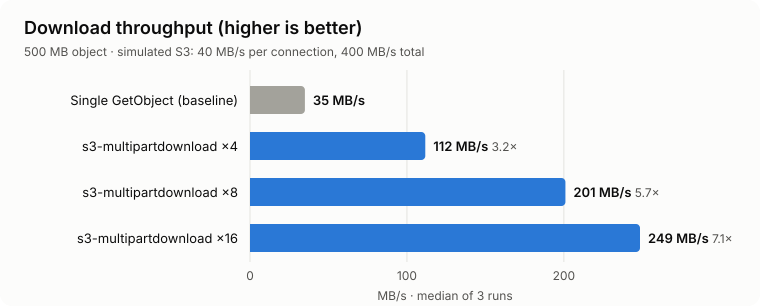
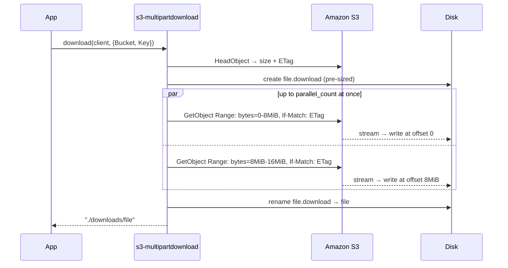

<div align="center">

# ⚡ s3-multipartdownload

**Fast, parallel S3 downloads for Node.js, built on AWS SDK v3.**
Splits large Amazon S3 objects into byte ranges, fetches them concurrently, and streams each one straight to disk. Memory use stays flat whatever the file size.

[](https://www.npmjs.com/package/s3-multipartdownload)
[](https://www.npmjs.com/package/s3-multipartdownload)
[](https://nodejs.org)
[](https://github.com/aws/aws-sdk-js-v3)
[](./index.d.ts)
[](#license)

**Up to 7.1× faster than a plain `GetObject`** ([simulated benchmark](#benchmarks)) · flat ~130 MB memory · zero runtime dependencies

</div>

---

<p align="center">
  
</p>

## Why?

A single `GetObject` request downloads over **one TCP connection**, and S3 throughput per connection is limited. AWS's own [performance guidelines](https://docs.aws.amazon.com/AmazonS3/latest/userguide/optimizing-performance-guidelines.html#optimizing-performance-guidelines-get-range) recommend fetching byte ranges in parallel to use more of your bandwidth. AWS SDK v3 for JavaScript ships a managed uploader (`@aws-sdk/lib-storage`) but **no parallel downloader**. This package fills that gap.

| | Single `GetObject` | **s3-multipartdownload** |
| --- | :---: | :---: |
| Parallel byte-range requests | ❌ | ✅ |
| Streams to disk (no full-file buffering) | ✅ | ✅ |
| Per-part retry, including mid-stream failures | ❌ | ✅ |
| Fails if the object changes mid-download (ETag pinning) | ❌ | ✅ |
| Atomic output (temp file + rename) | ❌ | ✅ |
| Progress callback and `AbortSignal` | manual | ✅ |
| TypeScript types | ✅ | ✅ |

## Installation

```bash
npm install s3-multipartdownload @aws-sdk/client-s3
```

Requires **Node.js 20.3+**. `@aws-sdk/client-s3` is a peer dependency, so you keep control of the SDK version and client configuration.

## Quick start

```js
const { S3Client } = require('@aws-sdk/client-s3')
const { download } = require('s3-multipartdownload')

const s3 = new S3Client({ region: 'us-east-1' }) // credentials from the default provider chain

const file = await download(s3, { Bucket: 'my-bucket', Key: 'datasets/big-file.parquet' }, {
  download_dir: './downloads',
  parallel_count: 8
})

console.log('Saved to', file) // ./downloads/big-file.parquet
```

<details>
<summary><b>ES modules / TypeScript</b></summary>

```ts
import { S3Client } from '@aws-sdk/client-s3'
import { download } from 's3-multipartdownload'

const file: string = await download(new S3Client({}), { Bucket: 'my-bucket', Key: 'video.mp4' })
```
</details>

## Usage recipes

### Progress bar

```js
await download(s3, params, {
  onProgress: ({ downloadedBytes, totalBytes }) => {
    const pct = totalBytes ? (downloadedBytes / totalBytes) * 100 : 100
    process.stdout.write(`\r${pct.toFixed(1)}%`)
  }
})
```

### Cancel or time out

```js
await download(s3, params, { abortSignal: AbortSignal.timeout(60_000) }) // give up after 60 s
```

When a download is aborted or fails, the partial `.download` temp file is removed.

### Specific version, encrypted objects, requester pays

Any `HeadObject`/`GetObject` parameter is passed through:

```js
await download(s3, {
  Bucket: 'my-bucket',
  Key: 'secret.bin',
  VersionId: '3HL4kqtJlcpXroDTDmJ',
  SSECustomerAlgorithm: 'AES256',
  SSECustomerKey: process.env.SSE_KEY,
  RequestPayer: 'requester'
}, { download_dir: './out', file_name: 'secret-v3.bin' })
```

### S3-compatible storage (MinIO, Cloudflare R2, Wasabi, DigitalOcean Spaces)

```js
const s3 = new S3Client({ endpoint: 'https://<account>.r2.cloudflarestorage.com', region: 'auto' })
await download(s3, { Bucket: 'assets', Key: 'build.tar.gz' })
```

## API

### `download(s3Client, s3Params, options?) → Promise<string>`

Resolves to the path of the downloaded file.

| Option | Default | Description |
| --- | --- | --- |
| `download_dir` | `.` | Output directory, created if missing |
| `file_name` | basename of `Key` | Output file name |
| `parallel_count` | `3` | Maximum concurrent range requests |
| `part_size` | `8 MiB` | Bytes per range request |
| `retries` | `3` | Extra attempts per part on network or 5xx errors. Other 4xx errors (except 408/429) and 412 are not retried |
| `abortSignal` | | `AbortSignal` that cancels the download |
| `onProgress` | | Called with `{ downloadedBytes, totalBytes }` as bytes arrive |

A `Range` in `s3Params` is ignored, and your `s3Params` object is never modified.

## How it works



1. **`HeadObject`** reads the size and ETag.
2. A **pre-sized temp file** lets every part write at its own offset, so there are no part files and no merge step.
3. Parts are fetched by a **bounded worker pool** (`parallel_count`), each sending `If-Match: <ETag>` so all bytes come from the same object version.
4. A failed part is **retried with backoff** and its progress is rolled back. A fatal error **cancels in-flight parts** and deletes the temp file.
5. On success the temp file is **atomically renamed** to the final name.

## Benchmarks

Full results: [`bench/results/RESULTS.md`](./bench/results/RESULTS.md) · raw data: [`results.json`](./bench/results/results.json)

**500 MB object** (median of 3 runs, SHA-256 verified):

| Strategy | Time | Throughput | Speed-up | Peak RSS |
| --- | ---: | ---: | ---: | ---: |
| Single `GetObject` (baseline) | 14.29 s | 35.0 MB/s | 1.00× | 134 MB |
| s3-multipartdownload ×4 | 4.48 s | 111.7 MB/s | **3.19×** | 133 MB |
| s3-multipartdownload ×8 | 2.49 s | 201.0 MB/s | **5.74×** | 130 MB |
| s3-multipartdownload ×16 | 2.01 s | 248.5 MB/s | **7.10×** | 127 MB |

**100 MB object:** 2.91 s → 0.41 s (**7.17×**) with ×16.

> [!NOTE]
> **These numbers come from a simulation, not live S3.** The benchmark runs a local S3-compatible server that caps each connection at 40 MB/s, total bandwidth at 400 MB/s, and adds 20 ms of latency per request. It ran on an Apple M1 (8 cores) with Node 22. With 16 parts the run tops out near 250 MB/s because the local server and the downloader share one machine's CPU. Real-world gains depend on your network, region and instance type, so measure against your own bucket:
>
> ```bash
> node bench/benchmark.js --bucket my-bucket --key path/to/big.bin --region us-east-1
> ```

Reproduce the simulation:

```bash
npm run bench
```

### Choosing `parallel_count` and `part_size`

- **Laptops / small instances:** `parallel_count: 4–8`
- **EC2 in the same region as the bucket:** `parallel_count: 16–32`; raise it until throughput stops improving
- Keep **`part_size` at 8–16 MiB**. Smaller parts add request overhead and cost (each part is a billed `GET`); larger parts retry more slowly.

## FAQ

<details>
<summary><b>Is this the same as S3 multipart upload?</b></summary>

No. Multipart *upload* is an S3 API. Multipart *download* is a client-side technique that uses HTTP `Range` requests on a normal `GetObject`. It works with any object, however it was uploaded.
</details>

<details>
<summary><b>Does it cost more?</b></summary>

Each part is one `GET` request. A 1 GB object at 8 MiB parts is 128 requests, which costs fractions of a cent at standard S3 pricing. Data transfer is the same as a single download.
</details>

<details>
<summary><b>How is this different from <code>aws s3 cp</code>?</b></summary>

The AWS CLI also downloads in parallel. Use it for shell scripts. Use this package when you need parallel downloads inside a Node.js app, Lambda or worker with no CLI dependency, with your own client configuration and progress and cancellation hooks.
</details>

<details>
<summary><b>Can I download to a stream or buffer instead of a file?</b></summary>

Not yet. Parallel parts arrive out of order, so writing to a file at known offsets keeps memory flat. Open an issue if you need this.
</details>

## Upgrading from 1.x

- Pass an SDK v3 `S3Client` instead of a v2 `AWS.S3` instance (aws-sdk v2 is end-of-support).
- `parallel_count` is now a concurrency limit. The object is split into `part_size` chunks rather than exactly `parallel_count` pieces.
- The promise resolves to the output file path. The library no longer logs to the console or loads `.env`.

## Development

```bash
npm install
npm test        # unit tests (node:test, mock S3 client)
npm run bench   # throughput benchmark against a simulated S3
```

## Contributing

Pull requests are welcome. For major changes, please [open an issue](https://github.com/ranjithkumarmv/s3-multipartdownload/issues) first to discuss what you'd like to change.

## License

[MIT](https://choosealicense.com/licenses/mit/)

---

<sub>**Keywords:** s3 parallel download · aws s3 download large file node.js · s3 multipart download · s3 range get · s3 getobject range · aws-sdk v3 download · fast s3 download · s3 download stream to file · s3 transfer manager javascript · concurrent s3 download · minio r2 download</sub>
